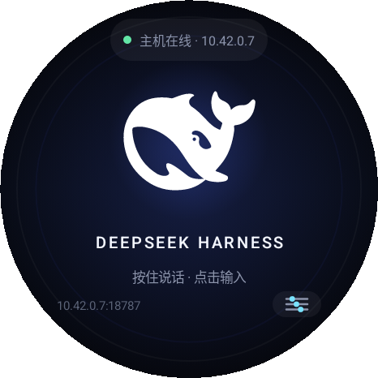
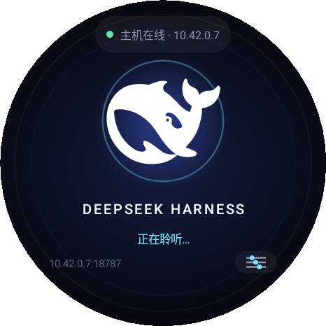
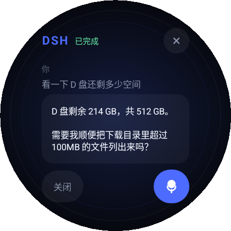
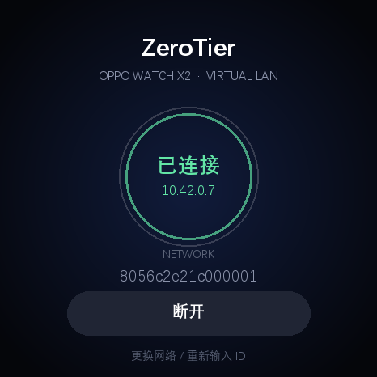
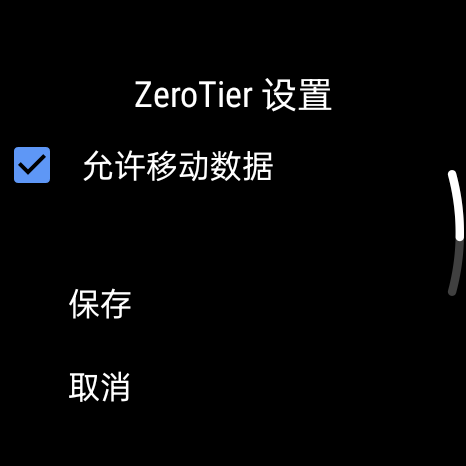
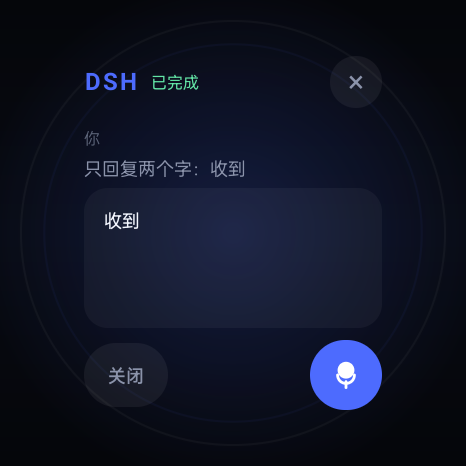
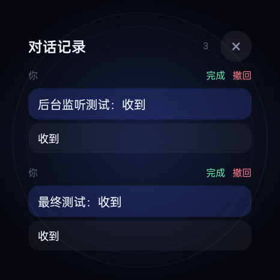
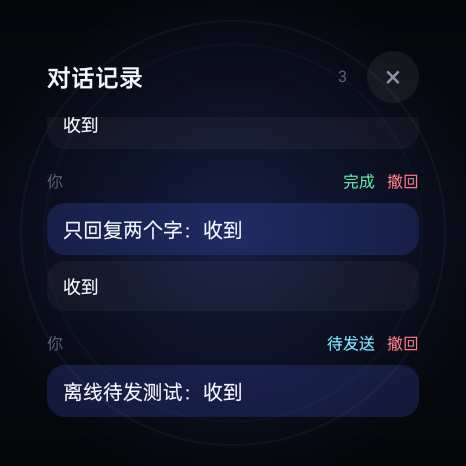
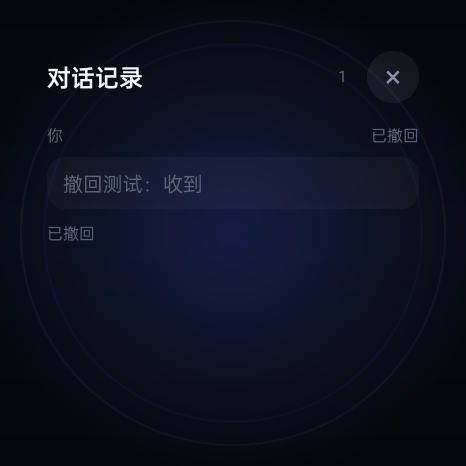

# DSH Watch · OPPO Watch X2

把 **DeepSeek Harness** 装进手表：抬腕按住鲸鱼 logo 说话，或者输入文字，指令经 **ZeroTier 虚拟局域网**送到主机，由主机上的 DSH 执行，结果回到表盘。

同时提供一个**表端 ZeroTier**：它仍然是 ZeroTier 官方的 1.12.0-3 内核与 `VpnService`，只把手机/平板的网络列表界面替换成了 466×466 圆屏界面。

> 本次实测机：OPPO Watch X2 `OWW251`，466×466、320dpi、Android 11（SDK 30）/ ColorOS Watch。  
> 系统版本不同（Wear OS 5 / ColorOS Watch 7）也能装，但 ZeroTier 的 VPN 授权页和语音入口需要按固件确认。

---

## 0. 成品预览

466×466 圆屏实机比例渲染（Paparazzi，320dpi）：

| 首页 | 长按聆听 | 回复 |
|---|---|---|
|  |  |  |

| ZeroTier 表端 | ZeroTier 设置（真机） |
|---|---|
|  |  |

| DSH 回复（真机） |
|---|
|  |

| 本地对话记录 | 离线待发 | 已撤回 |
|---|---|---|
|  |  |  |

> 真机截图来自 `OWW251`（466×466，320dpi），展示内容均为测试消息；图中的 IP、网络 ID 为渲染示例或已隐去。

`dist/` 里已经放好可直接安装的两个 APK、桥接服务和一键脚本。

---

## 1. 它是怎么工作的

```
┌──────────────────────────────┐        ZeroTier 虚拟局域网         ┌─────────────────────────────┐
│ OPPO Watch X2                │        （点对点 / 中继）            │ Windows / macOS / Linux 主机 │
│                              │                                    │                             │
│  DSH Watch APK               │  HTTP POST /api/prompt             │  DSH Watch Bridge (Node)     │
│  ├─ 大鲸鱼 logo / 长按语音   │ ─────────────────────────────────► │  ├─ 自动发现本机 DSH Web     │
│  ├─ 键盘输入                 │  NDJSON 流：accepted/delta/done     │  ├─ 创建/复用 DSH session    │
│  └─ 显示流式结果             │ ◄───────────────────────────────── │  └─ 调 DSH API 执行指令      │
│                              │                                    │                             │
│  ZeroTier Watch APK          │                                    │  ZeroTier One（主机端）      │
│  └─ 官方 1.12.0-3 内核       │                                    │  └─ 已加入同一个网络         │
└──────────────────────────────┘                                    └─────────────────────────────┘
```

- 手表端**不直接**调用 DSH 的内部接口，只和主机上的 `bridge` 说话；DSH 升级时只需要更新 bridge。
- bridge 通过本机 DSH 的浏览器会话密钥自动登录，不需要把 DeepSeek API Key 写进手表。
- 一次指令对应一个 DSH turn；同一个 session 会保留上下文，所以可以接着问“再把刚才那个文件删掉”。

---

## 2. 目录

```
dsh-watch/
├─ app/                         # DSH Watch（Kotlin + Jetpack Compose）
├─ bridge/                      # 主机端 Node 桥接服务
│  ├─ server.mjs
│  ├─ config.json
│  ├─ start-bridge.bat
│  └─ start-bridge.ps1
├─ zerotier-watch/              # ZeroTier 表端定制
│  ├─ src/.../NetworkListActivity.java
│  ├─ build-zerotier-watch.ps1
│  └─ ZeroTier-Watch-1.12.0.apk
├─ dist/                        # 可直接拿去安装的成品
│  ├─ DSH-Watch-1.0.0.apk
│  ├─ ZeroTier-Watch-1.12.0.apk
│  ├─ 安装到手表.bat / install-watch.ps1
│  ├─ 安装主机桥接.bat / install-bridge.ps1
│  ├─ host/                     # 主机桥接（server.mjs + config）
│  └─ preview-*.png
├─ tools/                       # apktool / baksmali 等构建工具
├─ shots/                       # 真机与 Paparazzi 截图（102 张）
├─ logs/                        # build / build-stack / paparazzi 日志
├─ tmp/                         # 一次性中间产物（可删）
├─ probe/                       # DSH Web 抓取副本与探针脚本
├─ 源码与安装包清单.md            # 源码结构 + 安装包校验值 + 重建命令
└─ README.md
```

---

## 3. 主机端：先让 DSH 跑起来

1. 打开 **DeepSeek Harness 桌面端**，确认已经登录、能正常对话。
2. 主机安装 **ZeroTier One**，加入你的虚拟局域网，记下主机在该网络里的 IP（例如本次实测的 `10.42.0.7`）。
   - Windows：`ipconfig`，找 `ZeroTier One [<16位网络ID>]` 的 IPv4。
   - 或：`zerotier-cli listnetworks`。
   - **PC 自己加入 ZeroTier 时，不需要路由器端口转发**；手表直接填 PC 的 ZT IP。
3. 启动桥接（二选一）：
   - 双击 `bridge/start-bridge.bat`；
   - 或在 PowerShell 里：
     ```powershell
     cd dsh-watch\bridge
     .\start-bridge.ps1
     ```
4. 看到下面这行即成功：
   ```
   DSH Watch Bridge listening on http://0.0.0.0:18787
   ```
5. 放行防火墙（管理员 PowerShell，只需一次）：
   ```powershell
   New-NetFirewallRule -DisplayName "DSH Watch Bridge 18787" `
     -Direction Inbound -Protocol TCP -LocalPort 18787 -Action Allow -Profile Any
   ```
6. 在主机浏览器打开 `http://127.0.0.1:18787/health`，应返回：
   ```json
   {"ok":true,"service":"dsh-watch-bridge",...}
   ```

> **端口冲突**：`18787` 被占用时，改 `bridge/config.json` 的 `port`，同时改手表里的端口。  
> **DSH 端口变了**：bridge 会自动扫描本机监听端口寻找 DSH；找不到时，把 `dshBaseUrl` 写成 `http://127.0.0.1:<端口>`。  
> **多网卡**：默认监听 `0.0.0.0`，ZeroTier 网卡和 Wi-Fi 都能访问。只想走 ZeroTier 时，把 `bind` 改成主机在 ZeroTier 里的 IP。

### 3.1 桥接配置

首次使用先把示例配置复制成真实配置（`config.json` 含令牌，已在 `.gitignore` 里排除）：

```powershell
Copy-Item bridge\config.example.json bridge\config.json
```

`bridge/config.json`：

| 字段 | 默认 | 说明 |
|---|---|---|
| `port` | `18787` | 监听端口，手表里要填同一个 |
| `bind` | `0.0.0.0` | 监听地址 |
| `token` | `change-me` | 手表请求令牌，**建议改掉** |
| `dshHome` | 空 | 空 = `%USERPROFILE%\.dsh` |
| `dshBaseUrl` | 空 | 空 = 自动发现；也可写死 `http://127.0.0.1:64490` |
| `workspace` | 空 | 空 = `bridge/agent`；DSH 的文件工具默认落在这里 |
| `maxText` | `2000` | 单条指令最大字符数 |
| `requestTimeoutMs` | `600000` | 单条指令超时（10 分钟） |

修改 `token` 后，手表里也要改：`设置 → 令牌`，或用 ADB 启动参数（见 4.3）。

---

## 4. 手表端：安装两个 APK

### 4.1 打开 ADB

OPPO Watch X2（Wear OS 5）：

1. 设置 → 系统 → 关于 → 连续点“版本号”7 次。
2. 设置 → 系统 → 开发者选项 → 打开 **ADB 调试**。
3. 打开 **通过 Wi-Fi 调试**，记下 IP 和端口；需要配对码时先 `adb pair`。

ColorOS Watch 版本路径类似：设置 → 关于手表 → 版本号 7 次 → 开发者选项 → ADB 调试。

电脑上：

```powershell
adb pair 192.168.1.50:37821     # 按手表显示的配对码输入
adb connect 192.168.1.50:5555
adb devices                     # 状态必须是 device
```

### 4.2 一键安装（推荐）

把 `dist/` 整个目录拷到电脑，双击 `安装到手表.bat`，按提示输入：

- 手表的 ADB 地址（已 `adb connect` 可留空）；
- 主机在 ZeroTier 里的 IP（例如 `10.42.0.7`）；
- 端口（默认 `18787`）和令牌（默认 `change-me`）。

脚本会：

1. 安装 **ZeroTier Watch**（`com.zerotier.one`）；
2. 安装 **DSH Watch**（`com.deepseek.dshwatch`）；
3. 用 `am start` 把主机 IP / 端口 / 令牌写进手表；
4. 尝试授予录音权限、延长息屏时间；
5. 打开 ZeroTier 让你点“允许 VPN”。

如果手表上已经装了官方 ZeroTier，签名不同会安装失败，脚本会提示先卸载（会丢原 app 数据）。

手动安装：

```powershell
adb install -r dist\ZeroTier-Watch-1.12.0.apk
adb install -r dist\DSH-Watch-1.0.0.apk
adb shell am start -n com.deepseek.dshwatch/.MainActivity `
  --es dsh_host 10.42.0.7 --ei dsh_port 18787 --es dsh_token change-me
adb shell monkey -p com.zerotier.one -c android.intent.category.LAUNCHER 1
```

### 4.3 手表里配置

打开 **DSH**：

- 首次没有主机时，点鲸鱼进入“主机设置”；
- 填 `ZeroTier IP / 主机名`、`端口`、`令牌`；
- 点“保存并测试”，显示“已连接”即可。

也可以完全用 ADB 预置（脚本已经做了）：

```powershell
adb shell am start -n com.deepseek.dshwatch/.MainActivity `
  --es dsh_host 10.42.0.7 --ei dsh_port 18787 --es dsh_token change-me
```

---

## 5. 使用

### 5.1 先连 ZeroTier

打开 **ZeroTier** 表端应用：

1. 首次点“加入网络”，输入 16 位十六进制 Network ID（ZeroTier Central 里复制）。
2. 点右上角三横线打开“ZeroTier 设置”，确认 **允许移动数据** 已勾选（只走 LTE 时必须开）。
3. 系统弹出 VPN 授权，向上滑动到底，点“确定”。
4. 回到 ZeroTier Central，给这个节点打勾授权（Auth）。
5. 表盘显示“已连接”和 `10.x.x.x` 地址即成功。

> 本次 OWW251 实测：LTE 下需要“允许移动数据”，VPN 授权页存在，节点授权后拿到 `10.42.0.8`，DSH 主机 `10.42.0.7:18787` 可直连，不需要路由器端口转发。

> 如果系统没有弹出 VPN 授权页，或提示“系统不支持 VPNService”，说明该手表的 ColorOS/Wear OS 固件裁掉了 VPN 确认界面。这种情况无法只靠 APK 解决，需要换用支持 VpnService 的固件/版本，或让主机做反向代理（不在本包范围内）。

### 5.2 连接 DSH

打开 **DSH**：

- 顶部状态：`主机在线 · 10.42.0.7`；
- **点一下鲸鱼**：打开键盘输入 → `↑` 发送；
- **长按鲸鱼**：有系统语音识别时直接识别；本机 ColorOS 没有标准 `RecognizerIntent`，会自动落到键盘输入；
- 键盘状态下可点搜狗键盘的麦克风，用搜狗语音输入，识别结果会写进输入框；
- 发送后自动进入 **对话记录**，可以看到“待发送 / 已发送 / 执行中 / 完成 / 已撤回”；
- 首页右下角 **两个气泡的图标** 随时打开本地对话记录。

语音识别用的是 Android 标准 `RecognizerIntent`。Wear OS 上通常由 Google 语音服务接管；本机 OWW251 实测没有这个服务，所以长按最终是键盘兜底。

### 5.3 本地记录、离线待发与撤回

这一版是 **本地优先** 的：

1. 点发送后消息先写进手表本地记录，状态 `待发送`；
2. 前台同步服务会持续尝试 `POST /api/enqueue`：
   - 网络没恢复：保持 `待发送`，按 5 秒退避重试；
   - 主机已接收：变成 `已发送 / 执行中`；
3. 主机把回复写进消息邮箱，手表用 `/api/events` **长轮询一直收**，即使 DSH 界面在后台也会更新记录；
4. 随时可点消息右上角 **撤回**：
   - 还没发出去：直接从待发队列撤回；
   - 已经发出去/执行中：通知 bridge 标记撤回，并尽量 `session/cancel` 停止主机执行；
5. 记录存在手表 `files/dsh_chat.json`，重启 DSH 或手表后仍在；
6. bridge 的邮箱存在主机 `bridge/messages.json`，手表重连后按 `seq` 补收漏掉的回复。

> 网络差的时候不需要反复点发送：发一次就会一直待命，链路恢复后自动发出。前台服务会显示“DSH 持续收信”的通知。

### 5.4 示例指令

- “看一下 D 盘还剩多少空间”
- “把下载目录里超过 100MB 的文件列出来”
- “帮我查一下昨天那个项目的构建日志，最后 50 行”
- “在 DSH WORK 下建一个 notes 目录，把刚才的结论写进去”

DSH 的文件/命令工具默认在 `bridge/agent` 工作区里操作；需要访问其他目录时，在指令里写绝对路径，是否允许取决于 DSH 的权限策略。

---

## 6. 安全

- 手表到 bridge 是 **HTTP + Bearer token**，不是 TLS。请只在 ZeroTier 私有网络里使用，不要把 `18787` 映射到公网。
- `token` 等于主机控制口令，泄露后别人可以在你主机上执行 DSH 指令。建议改成随机长字符串。
- bridge 会让 DSH 以当前用户权限执行工具；不要把手表借给不受信任的人。
- `autoApprove` 目前未启用；需要审批的工具调用不会自动放行，复杂写操作可能停在审批处。
- ZeroTier 网络本身也要在 Central 里做好成员授权，不要用公开网络。

---

## 7. 常见问题

**Q：`INSTALL_FAILED_UPDATE_INCOMPATIBLE`**  
A：手表上有官方 ZeroTier，签名不同。先 `adb uninstall com.zerotier.one`，再装表端版。会清掉原 app 数据。

**Q：`INSTALL_FAILED_VERIFICATION_FAILURE`**  
A：在开发者选项里关闭“验证可调试应用/通过 USB 安装校验”，或先 `adb install --bypass-low-target-sdk-block`（Android 14+）。

**Q：DSH 显示“主机离线”**  
A：依次检查：主机 bridge 是否在跑 → `http://主机ZT IP:18787/health` → Windows 防火墙 → 手表 ZeroTier 是否已连接 → 两边是否在同一 Network。

**Q：bridge 报“没有找到正在运行的 DSH Web”**  
A：先打开 DSH 桌面端；或在 `config.json` 写死 `dshBaseUrl`（DSH 窗口地址栏的 `http://127.0.0.1:端口`）。

**Q：回复很慢，一直“正在思考…”**  
A：复杂任务本来就要几分钟；bridge 超时是 10 分钟。可以先发“只回复一句话说明你收到了”，确认链路。

**Q：想清空上下文**  
A：删除 `bridge/state.json` 后重启 bridge，或 `curl -X POST -H "Authorization: Bearer <token>" http://127.0.0.1:18787/api/session/new`。

**Q：ZeroTier 显示“等待 Central 授权”**  
A：到 ZeroTier Central → Members，勾选新设备；或检查 Network ID 是否输错。

---

## 8. 开发与重新构建

### 8.1 DSH Watch

```powershell
$env:JAVA_HOME = "C:\Program Files\Java\jdk-17"
$env:ANDROID_HOME = "C:\Android\Sdk"
$env:ANDROID_USER_HOME = "C:\Users\<你>\.android"
$env:GRADLE_USER_HOME = "C:\Users\<你>\.gradle"
.\gradlew assembleDebug
```

> 本仓库没有提交 `gradlew`，用任意 Gradle 8.x 执行 `gradle -p . assembleDebug` 即可。

默认主机/端口/令牌在 `app/build.gradle.kts` 的 `buildConfigField` 里，也可以用：

```powershell
gradle -Pdsh.host=10.42.0.7 -Pdsh.port=18787 -Pdsh.token=你的令牌 assembleDebug
```

### 8.2 ZeroTier 表端

```powershell
.\zerotier-watch\build-zerotier-watch.ps1
```

脚本会：解包官方 APK（仅 smali，保留原始 resources/manifest）→ 编译 `NetworkListActivity.java` → d8/baksmali → 替换类 → apktool 回编译 → zipalign → apksigner 签名。  
产物：`zerotier-watch/ZeroTier-Watch-1.12.0.apk`。

原始 APK 需要放在 `zerotier-original.apk`，签名证书由脚本首次运行时用 keytool 生成（`zerotier-watch/zt-watch.keystore`）；该文件不要提交到仓库。  
这是**非官方修改版**，仅用于个人手表；请遵守 ZeroTier 的许可证，不要公开分发。

### 8.3 桥接协议（消息邮箱）

新表端使用“消息邮箱”，不再依赖一条长连接不中断：

`POST /api/enqueue`：

```json
{"id":"w-...","text":"帮我看一下磁盘"}
```

返回：

```json
{"ok":true,"id":"w-...","status":"queued"}
```

bridge 在后台执行，消息状态写入 `bridge/messages.json`：

```json
{
  "id":"w-...",
  "text":"帮我看一下磁盘",
  "status":"running|done|error|withdrawn",
  "reply":"D 盘剩余 214 GB",
  "phase":"正在执行第 2 步…",
  "error":null,
  "seq":12,
  "updatedAt":1794227412785
}
```

手表用长轮询收更新：

`GET /api/events?after=<seq>&timeout=20`

```json
{"ok":true,"events":[...],"lastSeq":15}
```

没有新事件时请求会挂起最多 `timeout` 秒，链路断开后自动重连，不会丢消息。

其他端点：

- `GET /health`（无需令牌，只返回服务状态）
- `GET /api/result?id=<id>`（Bearer token，查单条结果）
- `POST /api/withdraw`（Bearer token，`{"id":"w-..."}`，标记撤回并 abort 执行）
- `POST /api/cancel`（Bearer token，取消当前 HTTP prompt）
- `POST /api/session/new`（Bearer token）
- `GET /api/status`（Bearer token）

旧的 `POST /api/prompt` 仍保留，返回 NDJSON：`accepted / status / delta / done / error`，方便 curl 调试。

---

## 9. 已验证 / 未验证

已在 **OPPO Watch X2 `OWW251` 真机**验证：

- 两个 APK 安装、签名校验通过；
- ZeroTier 表端：移动数据设置、VPN 授权页、“允许移动数据”开关、`10.42.0.8` 入网；
- DSH 表端：长按/点击、输入、发送；
- **本地对话记录**：发送后立即写入，重启 DSH 仍在；
- **离线待发**：断网发送显示“待发送”，链路恢复后自动发出并收到回复；
- **后台持续收信**：发送后按 Home 把 DSH 切到后台，回复仍在记录里；
- **撤回**：已完成消息撤回后本地隐藏回复，状态变“已撤回”；
- ZeroTier 网络路径：表端 `10.42.0.8` → PC `10.42.0.7:18787`；
- 端到端：“只回复两个字：收到” → DSH 返回“收到”；
- 表端设置页可打开，PC 防火墙 18787 已放行。

未验证 / 固件相关：

- 本机 ColorOS **没有标准 Android 语音识别服务**，长按会落到键盘输入；可用搜狗键盘麦克风；
- 关机重启后 ZeroTier 表端能否自动恢复 VPN（DSH 的 BootReceiver 已加，但 ZeroTier 自身未改开机自启）；
- 其他系统版本（Wear OS 5 / ColorOS Watch 7）的 VPN 授权页差异；
- ZeroTier LTE 公共中继仍会间歇性丢包；现有队列会等待重试，但实时性无法保证。

---

## 10. 文件与许可

- `DSH Watch` 源码：本仓库，供个人使用。
- ZeroTier One Android：GPL-3.0（以官方仓库为准）；本包是未修改内核、仅替换启动 Activity 的个人适配版，未公开分发。
- DeepSeek Harness logo：来自本机 DSH Web 的 `favicon-dark.svg`，仅用于个人设备识别。
---

## 许可证

MIT License，见 [LICENSE](LICENSE)。
